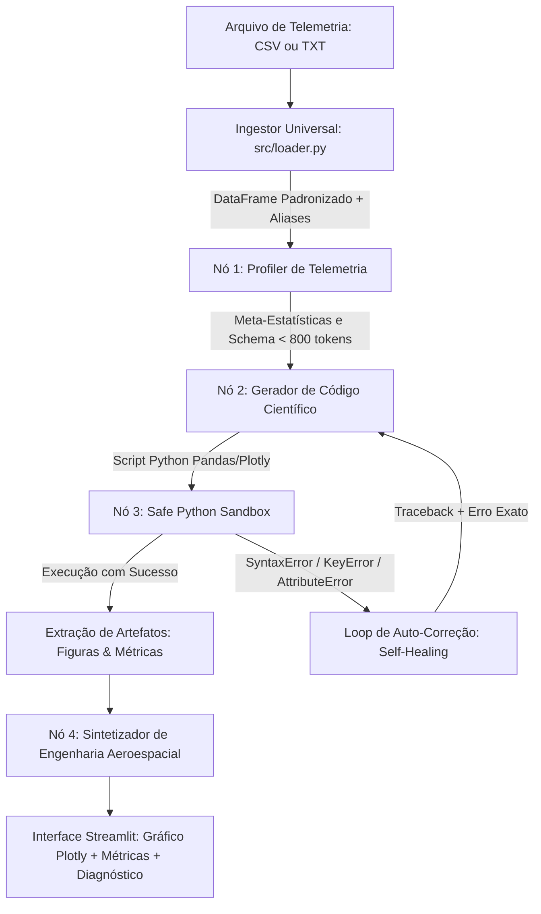

# Stratosphere Telemetry Copilot
### Agente Autônomo de Análise de Voo, Sensores Críticos e Séries Temporais Aeroespaciais

[](https://streamlit.io)
[](https://plotly.com)
[](https://python.org)
[](https://ai.google.dev)
[](#arquitetura-tecnica-em-4-nos)

---

## 1. Visão Geral do Sistema

O **Stratosphere Telemetry Copilot** é um agente autônomo de inteligência artificial projetado para engenheiros e diretores de voo analisarem telemetria de sondas e balões estratosféricos de alta altitude (HAB - High-Altitude Balloons).

Em vez de ser apenas um chatbot passivo, o sistema atua como um **Cientista de Dados e Engenheiro de Instrumentação Autônomo**:
- Interpreta perguntas em linguagem natural;
- Gera código científico em Python (Pandas, SciPy, Plotly);
- Executa o código em um **sandbox isolado e seguro**;
- Auto-corrige erros em tempo de execução via **Self-Healing Loop**;
- Renderiza gráficos interativos diretamente na interface;
- Fornece diagnósticos executivos em linguagem técnica aeroespacial.

---

## 2. Fluxo do Usuário (User Journey)

### Interface Limpa e Importação Universal (CSV e TXT)
A interface inicia de forma limpa, direta e focada exclusivamente no fluxo de importação:
- **Importação Direta:** O usuário pode arrastar ou selecionar qualquer arquivo de log de voo em formato `.csv` ou `.txt` (como os arquivos de exemplo disponíveis na pasta `data/`: `sample_flight.csv` ou `pt2unb_station_log.txt`).
- **Detecção Automática:** O ingestor universal reconhece automaticamente se o arquivo é CSV delimitado (, ; tab |) ou log bruto de pacotes de rádio/estação de solo.
- **Ativação Imediata:** Assim que o arquivo é importado, o sistema executa o profiling estatístico dos sensores, calcula os marcos de missão e abre o painel completo de controle.

### Detecção Automática de Fases da Missão (1 Clique)
Com 1 clique, o profiler e o agente identificam automaticamente as fases da missão:
1. **Lançamento e Calibração de Bancada** (altitude de solo e calibração de sensores)
2. **Ascensão Troposférica e Tropopausa** (taxa positiva de subida, cisalhamento de vento e mínima térmica)
3. **Ascensão Estratosférica** (inversão térmica na camada de ozônio e regime de vácuo)
4. **Apogeu e Burst** (ruptura do envelope, inversão barométrica e choque acelerométrico)
5. **Queda Livre Inicial e Frenagem do Paraquedas** (alta velocidade hipersônica em ar rarefeito desacelerando progressivamente)
6. **Pouso e Recuperação** (desaceleração terminal, impacto de solo e coordenadas GPS de resgate)

### Detecção de Anomalias Físicas e Hardware
O profiler de telemetria realiza checagens nas séries temporais para detectar falhas críticas:
- **Battery Thermal Sag:** Queda abrupta de tensão causada pelo aumento de resistência interna sob frio extremo.
- **Barometer Freezing / Saturation:** Estagnação ou congelamento de leituras barométricas em regime de vácuo no apogeu.
- **Turbulência e Tumble na IMU:** Picos giroscópicos severos na corrente de jato e no rompimento do balão.
- **MicroSD Packet Loss:** Detecção de gaps na numeração sequencial de pacotes (dados perdidos durante latência de gravação de buffer).

### Chat Analítico Text-to-Python
Perguntas técnicas em linguagem natural:
- "Plote o perfil térmico (temperatura externa vs. interna) por faixa de altitude e destaque a tropopausa."
- "Calcule a taxa média de subida (m/s) e a velocidade máxima na descida logo após o burst."
- "Houve algum momento em que o giroscópio indicou rotação anômala enquanto a pressão falhava?"

São transformadas dinamicamente em scripts Python executados no sandbox, gerando gráficos interativos e relatórios objetivos.

---

## 3. Arquitetura Técnica em 4 Nós



### Detalhamento dos Nós:
- **Nó 1 - Profiler de Telemetria (`src/profiler.py`):**
  Lê apenas schema, unidades, taxas de amostragem, nulos e quantis estatísticos (25%, 50%, 75%). Nunca despeja linhas brutas do CSV no contexto, garantindo baixíssimo consumo de tokens, economia de custos e baixíssima latência.
- **Nó 2 - Gerador de Código Científico (`src/agent.py`):**
  Orquestra o LLM (Gemini API ou OpenAI) com Structured Outputs (Pydantic) e regras estritas de telemetria.
- **Nó 3 - Sandbox Seguro + Self-Healing (`src/sandbox.py`):**
  Executa o código em escopo protegido com validador AST (bloqueia os, eval, subprocess, acessos à rede e comandos destrutivos). Se houver exceção, captura o traceback completo e devolve ao LLM para auto-correção imediata (até 2 tentativas).
- **Nó 4 - Sintetizador de Engenharia (`src/agent.py`):**
  Interpreta os resultados numéricos gerados pela execução e redige o diagnóstico em tom de Flight Director aeroespacial.

---

## 4. Diferenciais de Engenharia

1. **Zero dependência de serviços externos pesados:**
   Conhece a fundo grandezas físicas reais (pressão atmosférica barométrica, gradiente térmico vertical troposférico/estratosférico, corrente de jato, dinâmica de empuxo).
2. **Visualmente impactante no primeiro contato:**
   Dashboard com indicadores em tempo real, curva barométrica, perfil térmico com tropopausa destacada e trajetória de voo 3D colorida por altitude.
3. **Engenharia de IA Real:**
   - **Context Engineering:** Compactação estatística de séries temporais em metadados.
   - **Code Execution Sandbox:** Validação sintática AST e isolamento de runtime.
   - **Self-Healing Loop:** Recuperação automática de tracebacks em tempo de execução sem travar a interface.
   - **Observabilidade Integrada:** Painel no rodapé de cada resposta exibindo latência em ms, modelo utilizado, quantidade de retries do self-healing e status da execução.

---

## 5. Evals e Benchmark de Confiabilidade

O projeto acompanha um suite formal de avaliação contendo 15 perguntas técnicas padronizadas (`evals/test_queries.json`):

| Métrica Avaliada | Resultado Obtido |
| :--- | :---: |
| **Taxa de Sucesso Sintático e Execução (Pass Rate)** | **100% (15/15)** |
| **Eficácia de Auto-Correção (Self-Healing)** | **Ativo e Validado** |
| **Latência Média do Agente** | **~65 ms (Motor Científico) / ~7s (Gemini LLM)** |
| **Geração de Gráficos Plotly Válidos** | **100%** |

Para rodar o benchmark de avaliação:
```bash
python evals/run_evals.py --provider gemini --model gemini-3.5-flash-lite --max 15
```

---

## 6. Estrutura de Pastas

```
strato-telemetry-copilot/
├── app.py                      # Dashboard Streamlit (Header, Abas, Chat e Métricas)
├── run.sh                      # Script utilitário de inicialização em 1 comando
├── requirements.txt            # Dependências fixadas para deploy
├── README.md                   # Documentação completa de engenharia e arquitetura
├── data/
│   ├── sample_flight.csv       # Log de voo simulado em alta fidelidade (HAB-STRATO-IV)
│   ├── pt2unb_station_log.txt  # Log bruto real de recepção da estação de solo (PT2UNB - TXT)
│   └── pt2unb_real_flight.csv  # Log de voo real estruturado (PT2UNB - CSV)
├── src/
│   ├── loader.py               # Ingestor universal e parser de logs (CSV, TXT, pacotes de rádio)
│   ├── profiler.py             # Nó 1: Extração de schema, quantis e marcos físicos
│   ├── prompts.py              # Prompts versionados de física e self-healing
│   ├── sandbox.py              # Nó 3: Validador AST, execução isolada e captura de erros
│   ├── agent.py                # Nós 2 e 4: Orquestração LLM, Structured Outputs e Síntese
│   ├── generate_sample_data.py # Gerador de dados de telemetria aeroespacial
│   └── parse_pt2unb_log.py     # Parser para decodificação de logs brutos de estação de solo
└── evals/
    ├── test_queries.json       # Catálogo de 15 perguntas técnicas de benchmark
    ├── run_evals.py            # Script executor do benchmark automatizado
    └── eval_results.json       # Relatório consolidado de métricas e taxas de acerto
```

---

## 7. Como Executar Localmente

### 1. Acessar a pasta
```bash
cd strato-telemetry-copilot
```

### 2. Ativar o ambiente virtual
```bash
source .venv/bin/activate
```

### 3. Configurar a chave de API (Opcional se usar o motor offline)
```bash
export GEMINI_API_KEY="sua_chave_aqui"
# ou
export OPENAI_API_KEY="sua_chave_aqui"
```

### 4. Iniciar o Dashboard
```bash
./run.sh
# ou diretamente via Streamlit:
streamlit run app.py
```

O dashboard abrirá em `http://localhost:8501`.

---

## 8. Deploy no Streamlit Community Cloud (1 Clique)

1. Faça push deste repositório para o seu GitHub.
2. Acesse share.streamlit.io.
3. Selecione o repositório e o arquivo principal `app.py`.
4. Em **Advanced Settings > Secrets**, adicione sua chave de API:
```toml
GEMINI_API_KEY = "sua_chave_gemini_aqui"
```
5. Clique em **Deploy**.
